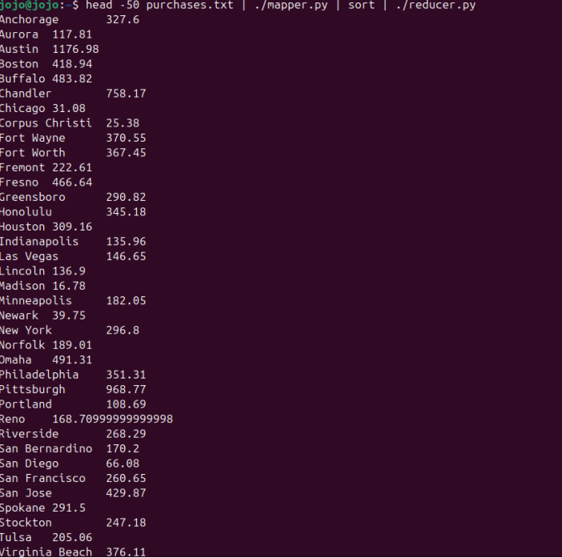
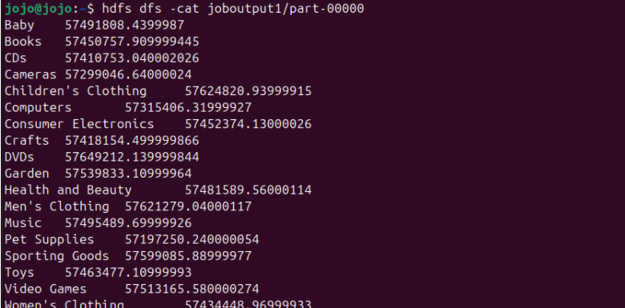

# Hadoop MapReduce: Sales Analysis with Python

Analysis of a file of more than 4 million sales transactions using **MapReduce**, with **Hadoop Streaming** and **Python 3** scripts.

Results report: [docs/rapport.pdf](docs/rapport.pdf)

## Data

The `purchases.txt` file contains one transaction per line, with 6 tab-separated fields:

| Field | Description | Example |
|---|---|---|
| `date` | Transaction date | 2012-12-31 |
| `time` | Transaction time | 17:59 |
| `store` | Store city | Norfolk |
| `category` | Product category | Toys |
| `amount` | Sale amount | 164.34 |
| `payment` | Payment method | MasterCard |

The file is large and is not included in this repository. Place it at the project root for local tests, or on HDFS for Hadoop jobs.

## Principle

```
purchases.txt --> Mapper --> Shuffle and sort by key --> Reducer --> Result
```

The mapper extracts a key (store or category) and the amount. Hadoop groups the pairs by key, then the reducer aggregates them.

## Structure

```
src/
├── mapper_store.py     # store     <TAB> amount
├── mapper_item.py      # category  <TAB> amount
├── reducer_sum.py      # sum per key
├── reducer_max.py      # maximum per key
└── reducer_total.py    # total sales and number of transactions
docs/
├── rapport.pdf
└── images/
```

| Analysis | Mapper | Reducer |
|---|---|---|
| Sales per store | `mapper_store.py` | `reducer_sum.py` |
| Sales per category | `mapper_item.py` | `reducer_sum.py` |
| Highest sale per store | `mapper_store.py` | `reducer_max.py` |
| Overall total and number of sales | `mapper_store.py` | `reducer_total.py` |

## Usage

**Local test on a sample:**

```bash
head -50 purchases.txt | python3 src/mapper_store.py | sort | python3 src/reducer_sum.py
```



**Running on Hadoop:**

```bash
hdfs dfs -mkdir -p myinput
hdfs dfs -put purchases.txt myinput/

hadoop jar $HADOOP_HOME/share/hadoop/tools/lib/hadoop-streaming-*.jar \
  -files src/mapper_store.py,src/reducer_sum.py \
  -mapper "python3 mapper_store.py" \
  -reducer "python3 reducer_sum.py" \
  -input myinput/purchases.txt \
  -output joboutput_store_sales

hdfs dfs -cat joboutput_store_sales/part-00000
```

For the other analyses, change the scripts according to the table and the output directory (it must not already exist). The JAR path depends on the Hadoop installation.

## Results

| Question | Result |
|---|---|
| Sales of the Buffalo store | 10,001,941.19 |
| Sales of the Toys category | 57,463,477.11 |
| Sales of the Consumer Electronics category | 57,452,374.13 |
| Highest sale in Reno / Toledo / Chandler | 499.99 / 499.98 / 499.98 |
| Overall total sales | 1,034,457,953.26 |
| Total number of transactions | 4,138,476 |




## Author

Abdessamad Ait brahim, [@abdessamadaitbrahim](https://github.com/abdessamadaitbrahim)